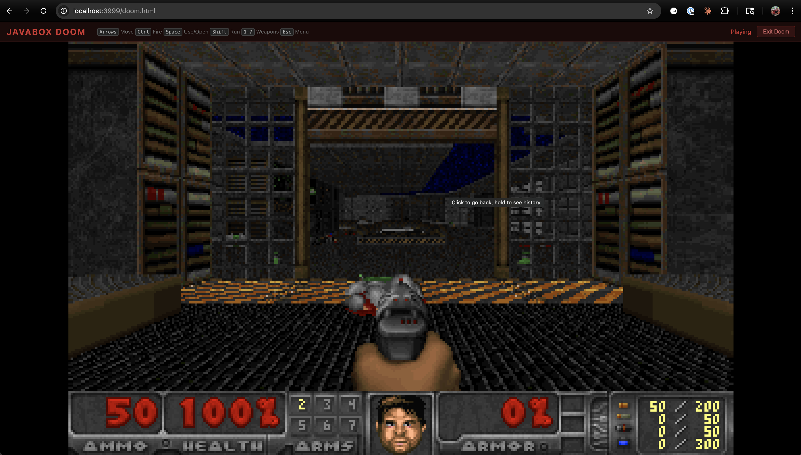

# JavaBox

Run Java in the browser. No server-side JVM required.

**[Live Demo](https://javabox-demo.brian-fec.workers.dev/)**


JavaBox compiles OpenJDK 21 (Zero interpreter) directly to WebAssembly via Emscripten. Write, compile, and execute Java code entirely inside the browser tab — no backend needed.

## Doom in the Browser

JavaBox can run [Mocha Doom](https://github.com/axelkohlmeyer/mochadoom) — a pure-Java Doom engine — rendered to an HTML Canvas at ~30 FPS with keyboard input and sound effects.



<video src="docs/doom.mp4" controls width="100%"></video>

**[Play Doom](https://javabox-demo.brian-fec.workers.dev/doom.html)**

## How It Works

```
Browser tab
  └── Emscripten WASM module (~3MB code + ~72MB data)
        └── OpenJDK 21 Zero interpreter (compiled to WASM)
              └── CompileServer (persistent JVM daemon)
                    ├── javax.tools.JavaCompiler (compile)
                    ├── URLClassLoader (run)
                    └── Mocha Doom (Canvas rendering + Web Audio)
```

A persistent **CompileServer** daemon runs inside the JVM. Compilation and execution happen in-process via `javax.tools.JavaCompiler` and `URLClassLoader`, avoiding JVM startup overhead entirely.

**Performance:** ~3-5s boot, sub-second compile+run.

### Doom Architecture

Doom runs entirely in Java with zero native UI dependencies:

- **Video:** Java renders to `BufferedImage` → JNI native copies ARGB pixels to shared WASM heap as RGBA → browser `requestAnimationFrame` draws via `putImageData`
- **Audio:** Java 8-channel mixer produces 16-bit stereo PCM (22050Hz) → JNI native writes to shared ring buffer → browser Web Audio API plays via `AudioBufferSourceNode`
- **Input:** Browser posts key events directly to a C-side queue via WASM export → Java polls the queue each frame via JNI — no Java threads needed (Emscripten pthread creation is unreliable)

## Repository Structure

```
openjdk/            Forked OpenJDK 21u with Emscripten OS abstraction layer
container/          Dockerfile + CompileServer + Doom adapter classes
  doom/             Mocha Doom source + adapter (TerminalEngine, CanvasRenderer)
build/              Build scripts (compile, link, deploy, serve)
  jvm-main.c        JVM entry point + stdin bridge + Canvas/Audio/Input native methods
  CompileServer.java  In-memory compilation daemon
web/                Frontend (index.html editor, doom.html game)
packages/
  sdk/              TypeScript SDK (@javabox/sdk)
tests/              Playwright e2e tests
```

## Prerequisites

| Tool | Purpose | Install |
|------|---------|---------|
| [Emscripten SDK](https://emscripten.org) | Compile OpenJDK to WASM | [emsdk](https://emscripten.org/docs/getting_started/downloads.html) |
| Host JDK 21 | Build JDK class library + Doom | `brew install openjdk@21` |
| Node.js 20+ | Local dev server, tests | `brew install node` |

## Build

### Full build (recommended)

```sh
./build/build-direct.sh ~/javabox-wasm --with-doom
```

### Individual steps

```sh
./build/build-jvm-wasm.sh           # Compile OpenJDK HotSpot Zero → libjvm.a
./build/build-jdk-modules.sh        # jlink JDK class library on host
./build/build-doom-jar.sh           # Compile Doom Java sources
./build/link-direct-wasm.sh ~/out --with-doom  # Final emcc link → .mjs + .wasm + .data
```

### Serve locally

The WASM files require `Cross-Origin-Opener-Policy: same-origin` and `Cross-Origin-Embedder-Policy: require-corp` headers for `SharedArrayBuffer`.

```sh
python3 build/serve.py ~/javabox-wasm 3000
# http://localhost:3000/index.html    — Java editor
# http://localhost:3000/doom.html     — Doom
```

## Deploy to Cloudflare

```sh
npm install --userconfig /dev/null wrangler
npx --userconfig /dev/null wrangler login
./build/deploy-cloudflare.sh ~/javabox-wasm
```

## Architecture

### CompileServer

The key innovation is a persistent JVM daemon (`build/CompileServer.java`) that:

1. Compiles Java source in-process via `javax.tools.JavaCompiler` with an in-memory file manager
2. Runs compiled classes in-process via custom `MemoryClassLoader` (defineClass from byte[])
3. Responds to a simple line protocol over stdin/stdout

Protocol:
- **Boot detection:** Browser sends `JBOX_PING`, CompileServer responds `JBOX_PONG`
- **Compile+Run:** `JBOX_COMPILE <ClassName>\n<source>\nJBOX_END\n` → output + `JBOX_EXIT:<code>`
- **Doom:** `JBOX_DOOM\n` → starts Mocha Doom in-process with Canvas rendering

### Direct WASM Mode

OpenJDK 21's Zero interpreter (pure C++ bytecode interpreter, no JIT) is compiled to WebAssembly via Emscripten. Key technical details:

- **Threading:** `PROXY_TO_PTHREAD` runs main() on a Web Worker; Emscripten pthread pool provides additional workers
- **Memory:** 256MB initial, 512MB max, Serial GC
- **Stdin bridge:** SharedArrayBuffer ring buffer with `Atomics.wait`/`Atomics.notify` for browser→JVM communication
- **Static linking:** All native libraries (libjvm, libjava, libjimage, libzip, libnio, libffi) linked into one WASM binary
- **Symbol dispatch:** Static symbol table with binary search replaces `dlsym` for JNI native method resolution

## Known Constraints

- **Interpreter only:** Zero interpreter (no JIT) — sufficient for interactive use
- **Memory:** 512MB max heap
- **Emscripten pthreads:** JVM internal threads (Finalizer, GC) may fail to start; game loop and compilation work on the main pthread
- **Browser support:** Requires SharedArrayBuffer — Chrome 92+, Firefox 79+, Safari 15.2+, Edge 92+

## Development

```sh
# Type-check the SDK
cd packages/sdk && npx tsc --noEmit

# Run e2e tests (requires local server on port 3999)
npx playwright test tests/doom-canvas-diag.spec.js
npx playwright test tests/e2e-debug.spec.js
```
