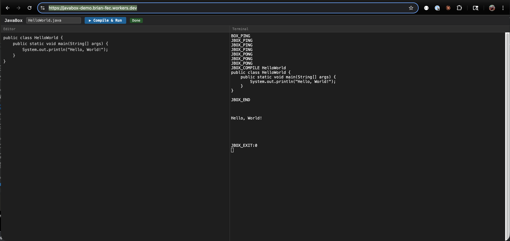

# JavaBox

Run Java in the browser. No server-side JVM required.

**[Live Demo](https://javabox-demo.brian-fec.workers.dev/)**



JavaBox packages an Alpine Linux 3.21 + OpenJDK 21 container into browser-runnable WebAssembly using [container2wasm](https://github.com/container2wasm/container2wasm). Write, compile, and execute Java code entirely inside the browser tab — no backend needed.

## How It Works

```
Browser tab
  └── Cloudflare Worker (COOP/COEP headers)
        └── Emscripten + QEMU Wasm (x86_64 TCG emulation)
              └── Linux kernel
                    └── Alpine Linux 3.21
                          └── OpenJDK 21 (jlinked, 23 modules)
                                └── CompileServer (persistent JVM daemon)
```

A persistent **CompileServer** daemon loads the JVM once during container2wasm snapshot capture. After snapshot restore in the browser, the JVM is already warm — compilation and execution happen in-process via `javax.tools.JavaCompiler` and `URLClassLoader`, avoiding JVM startup overhead entirely.

**Performance:** ~20s boot, ~35s compile+run HelloWorld. Total ~55s from page load to output.

## Repository Structure

```
container/          Dockerfile — Alpine Linux 3.21 + OpenJDK 21 + CompileServer
  CompileServer.java  Persistent compilation daemon (survives snapshot restore)
build/              Build scripts (convert, deploy, optimize, serve)
  cloudflare/       Cloudflare Worker + R2 deployment
  deploy-cloudflare.sh  One-command deploy to Cloudflare
web/                Demo pages (terminal + Monaco editor playground)
packages/
  sdk/              TypeScript SDK (@javabox/sdk)
  relay/            c2w-net relay server (optional networking)
examples/           Minimal usage examples
scripts/            CI and benchmark helpers
tests/              Playwright e2e tests
```

## Prerequisites

| Tool | Platform | Purpose | Install |
|------|----------|---------|---------|
| [Rancher Desktop](https://rancherdesktop.io) | macOS | Container build | `brew install --cask rancher` |
| [Colima](https://github.com/abiosoft/colima) | macOS arm64 | WASM conversion (x86_64 VM) | `brew install colima` |
| container2wasm v0.8.3 | Linux x86_64 | WASM conversion (fast/CI) | See Step 2 |
| Node.js 20+ | All | SDK build, local dev server | `brew install node` |

## Step 1 — Build the Container Image

> **macOS**: Rancher Desktop must be running. The build uses `~/.rd/bin/docker`.

```sh
~/.rd/bin/docker build \
  --platform linux/amd64 \
  -t javabox:latest \
  ./container/
```

Smoke test:

```sh
~/.rd/bin/docker run --rm --platform linux/amd64 javabox:latest bash -c '
  java -version && javac -version && java --list-modules | wc -l
'
```

## Step 2 — Convert to WASM

The conversion step produces static artifacts that are reused for all subsequent development — you only re-run this when the `container/Dockerfile` changes.

```sh
# Apple Silicon macOS (uses Colima x86_64 VM)
./build/convert.sh ~/javabox-wasm

# Linux x86_64 (native c2w, fast)
./build/convert.sh --mode linux /tmp/javabox-wasm
```

See `build/convert.sh --help` for details.

## Step 3 — Serve Locally

The WASM files require `Cross-Origin-Opener-Policy: same-origin` and `Cross-Origin-Embedder-Policy: require-corp` headers for `SharedArrayBuffer`.

```sh
python3 build/serve.py ~/javabox-wasm 3000
# open http://localhost:3000
```

## Step 4 — Deploy to Cloudflare

JavaBox is deployed via a Cloudflare Worker + R2 bucket. The Worker serves all files from R2 with the required COOP/COEP headers.

```sh
# One-time setup
npm install --userconfig /dev/null wrangler
npx --userconfig /dev/null wrangler login

# Deploy
./build/deploy-cloudflare.sh ~/javabox-wasm
```

## Architecture

### CompileServer

The key innovation is a persistent JVM daemon (`container/CompileServer.java`) that:

1. Loads during container2wasm snapshot capture (slow, but only happens once at build time)
2. Survives QEMU snapshot restore in the browser (uses simple `BufferedReader`, no JLine)
3. Compiles Java source in-process via `javax.tools.JavaCompiler`
4. Runs compiled classes in-process via `URLClassLoader`

Protocol:
- **Boot detection:** Browser sends `JBOX_PING`, CompileServer responds `JBOX_PONG`
- **Compile+Run:** `JBOX_COMPILE <ClassName>\n<source>\nJBOX_END\n` → output + `JBOX_EXIT:<code>`

### Why not standalone javac/java?

Under QEMU TCG WASM emulation (x86 → TCG → WASM → native), JVM startup takes 12+ minutes. CompileServer eliminates this by keeping the JVM loaded across compilations.

## Known Constraints

- **Guest RAM**: 128MB (`-m 128M`), heap limited to `-Xmx64m`
- **Interpreter only**: `-Xint` (JIT disabled — not useful under TCG emulation)
- **Boot time**: ~20s from page load to CompileServer ready
- **Bundle size**: ~227MB data file (contains full container filesystem + QEMU snapshot)
- **Browser support**: Requires SharedArrayBuffer — Chrome 92+, Firefox 79+, Safari 15.2+, Edge 92+

## Development

```sh
# Type-check the SDK
cd packages/sdk && npx tsc --noEmit

# Run e2e tests (requires local server on port 3999)
npx playwright test tests/e2e-debug.spec.js
```
